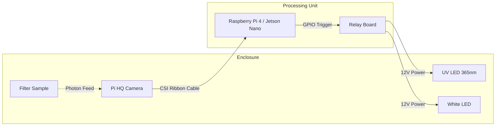
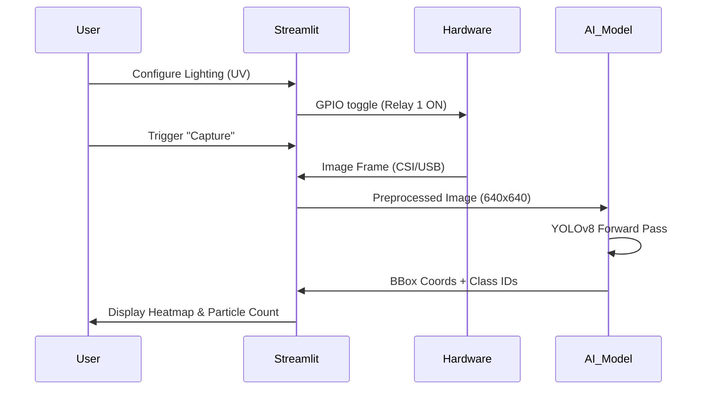
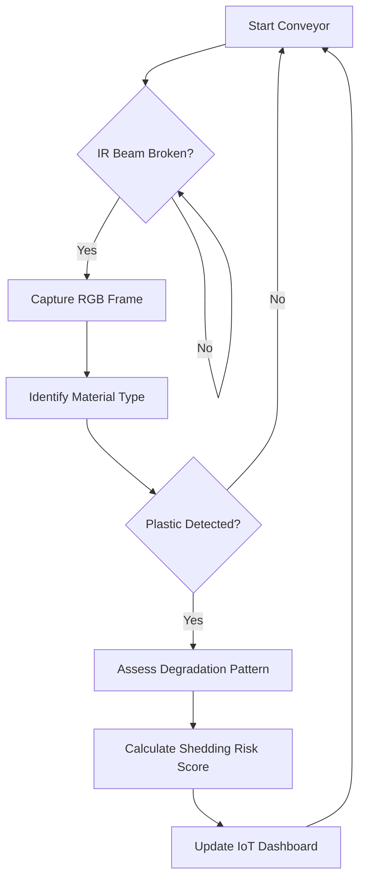

# System Architecture & Workflow Diagrams

This document contains visual representations of the system logic.

## 1. Physical Hardware Layout

## 2. Software Execution Sequence

## 3. Solid Waste Detection Logic

